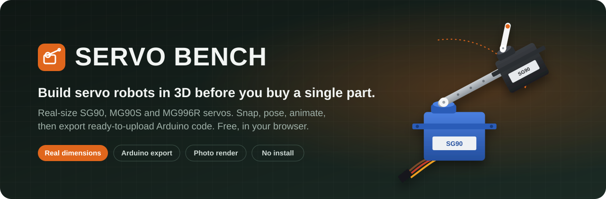
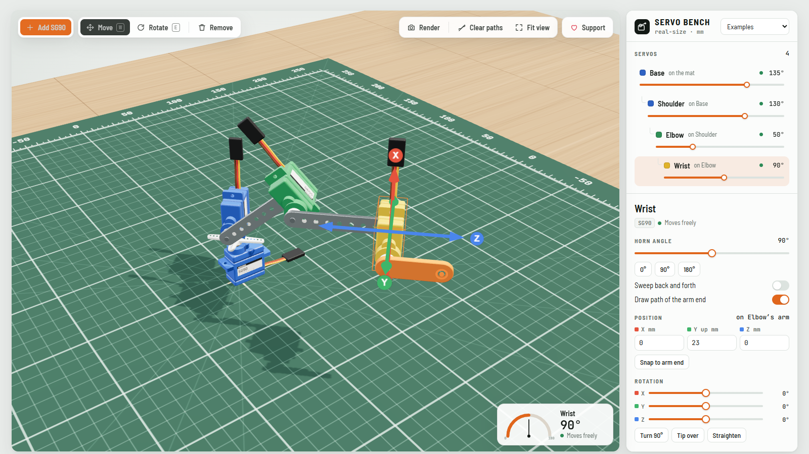

<p align="center">
  <a href="https://python736.github.io/servo-bench/"></a>
</p>

<p align="center">
  <a href="https://python736.github.io/servo-bench/"></a>
  <a href="https://python736.github.io/servo-bench/?example=arm3"></a>
  <a href="https://github.com/Python736/servo-bench/stargazers"></a>
  <a href="LICENSE"></a>
</p>

<p align="center">
  <b>No install · No account · Runs in any modern browser</b>
</p>

<br>

<p align="center">
  <a href="https://python736.github.io/servo-bench/?example=arm3">
    <picture>
      <source media="(prefers-color-scheme: dark)" srcset="assets/screenshot-dark.png">
      <source media="(prefers-color-scheme: light)" srcset="assets/screenshot-light.png">
      
    </picture>
  </a>
</p>

## Why Servo Bench?

Hobby servos are cheap, but designing with them is guesswork. Will the arm reach? Does the second servo hit the first one? Which way does the horn turn?

**Servo Bench lets you find out before you buy, print or wire anything.** Every servo is modelled at its real datasheet size, moves at its real rated speed, and snaps together the way real servos do. When the design works, it gives you the Arduino code and the shopping list.

## ✨ Features

<table>
<tr>
<td width="50%" valign="top">

### 📏 Real-size servos
**SG90**, **MG90S** and **MG996R**, built to datasheet dimensions in millimetres, with mounting tabs, output shafts and wires where they really are.

</td>
<td width="50%" valign="top">

### 🧲 Drag, drop, connect
Drop a servo on an orange dot to mount it on another servo's arm or body. Pull it away to unplug it. Chains can be as long as you like.

</td>
</tr>
<tr>
<td valign="top">

### 🎛️ Free movement
Move with arrows, rotate with rings (5° snapping, or hold <kbd>Shift</kbd> for free rotation), or type exact numbers. Drag a horn to turn the shaft.

</td>
<td valign="top">

### ⏱️ Realistic motion
Servos turn at their rated speed and show the load from everything they carry. Turn on **Draw path** to trace where the arm end goes.

</td>
</tr>
<tr>
<td valign="top">

### 🎬 Motion steps
Pose the build, save it as a step, and repeat. **Play** runs the whole sequence in a loop, the same way your real robot will.

</td>
<td valign="top">

### 🔌 Arduino code export
A ready-to-upload sketch for **Arduino Uno / Nano / Mega** or **ESP32**. You pick the pins, all servos arrive together, and timing comes from each servo's real speed.

</td>
</tr>
<tr>
<td valign="top">

### 🛒 Parts list
Everything you need to build it: servos, links, brackets, board, and a power supply sized for your servos, with shop links.

</td>
<td valign="top">

### 📸 Photo render
One click gives you a path-traced, photo-real picture of your build (the same technique as Blender Cycles) that you can save as a PNG.

</td>
</tr>
</table>

## 🚀 From idea to real robot

```text
 1. Build          2. Animate             3. Export               4. Buy & wire
 ─────────         ──────────             ─────────               ─────────────
 Drag servos  ──▶  Save poses as     ──▶  Arduino code with  ──▶  Parts list with
 onto arms         steps, press Play      your pins & timing      shop links
```

Here's a sample of the generated code:

```cpp
const int STEP_COUNT = 2;
const int STEPS[STEP_COUNT][SERVO_COUNT] = {
  { 135, 130,  50,  90 },  // step 1
  {  45, 100,  80,  20 },  // step 2
};
// Time to move into each step (ms), from the servos' rated speed.
const unsigned int MOVE_MS[STEP_COUNT] = {  300,  300 };
```

## 🧪 Example builds

Open any of these straight in the app:

| Example | What it shows |
|---|---|
| [**3-joint arm**](https://python736.github.io/servo-bench/?example=arm3) | Base, shoulder, elbow and wrist, with the wrist path traced |
| [**Pan-tilt**](https://python736.github.io/servo-bench/?example=start) | The classic camera mount, plus a spare servo to play with |
| [**Back-to-back pair**](https://python736.github.io/servo-bench/?example=b2b) | A servo mounted on another servo's case |
| [**Flat 2-link arm**](https://python736.github.io/servo-bench/?example=scara) | A SCARA-style arm drawing its reach |

## ⌨️ Controls

| Action | How |
|---|---|
| Move a servo | Drag it, or use the arrows (<kbd>W</kbd>) |
| Rotate a servo | Rings (<kbd>E</kbd>), <kbd>R</kbd> to turn 90°, <kbd>T</kbd> to tip it over |
| Turn the shaft | Drag the white horn |
| Nudge | Arrow keys, <kbd>PageUp</kbd> / <kbd>PageDown</kbd> (hold <kbd>Shift</kbd> for 1 mm) |
| Photo render | <kbd>L</kbd>, or the **Render** button. <kbd>Esc</kbd> stops it |
| Remove | <kbd>Delete</kbd> |
| Camera | Drag empty space to orbit, right-drag to pan, scroll to zoom |

## 💻 Run it locally

There's nothing to install or build. Download the repo and open `index.html` in Chrome, Edge or Firefox. It loads [three.js](https://threejs.org) from a CDN, so it needs internet the first time.

Link options: `?example=arm3` opens an example, `?theme=light` or `?theme=dark` forces a theme, and `?tips=0` hides the tips card.

> **Laptop with two graphics chips?** If the 3D view feels slow, set your browser to **High performance** in *Windows Settings → System → Display → Graphics*. The app also lowers its resolution automatically while things move, and goes back to full sharpness when they stop.

## 🗺️ Roadmap

- [x] Real-size SG90, MG90S, MG996R
- [x] Motion steps and playback
- [x] Arduino and ESP32 code export
- [x] Parts list
- [x] Photo render
- [ ] More servos (DS3218, MG92B, continuous rotation)
- [ ] Brackets and 3D-printable parts library
- [ ] Inverse kinematics: drag the arm tip and the joints follow
- [ ] Export to STL for 3D printing

Have an idea? [Open an issue](https://github.com/Python736/servo-bench/issues/new).

## ❤️ Support

Servo Bench is free, open source and ad-free. If it saved you time or a burnt-out servo:

- ⭐ **Star this repo**. It really helps others find it.
- 🔗 **Share it** with a friend or your maker community.
- ☕ **Donate** with the ❤ **Support** button in the app.

<details>
<summary>For maintainers: setting up donations</summary>

Donation buttons and the Amazon affiliate tag live in the `window.SERVO_BENCH` block in `index.html`. A service only shows up once its username is filled in. The GitHub Sponsor button is set in `.github/FUNDING.yml`.

</details>

## 🧱 Built with

[three.js](https://github.com/mrdoob/three.js) · [three-gpu-pathtracer](https://github.com/gkjohnson/three-gpu-pathtracer) · [three-mesh-bvh](https://github.com/gkjohnson/three-mesh-bvh), all MIT-licensed.

## 📄 License

[MIT](LICENSE): free to use, change and share, including commercially.
